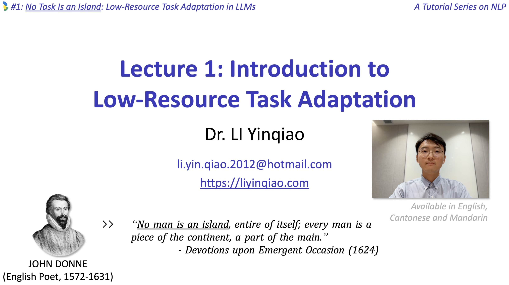

Delivered the first online [lecture](https://www.youtube.com/watch?v=ho6TXCtjbBY) introduces our tutorial series on low-resource task adaptation for LLMs. We review the foundations of language modeling, outline the LLM development and adaptation pipeline, and explain why task-specific data scarcity remains a critical challenge. We then introduce three key research directions that guide the series: data construction, effective model training, and reliable inference. 

